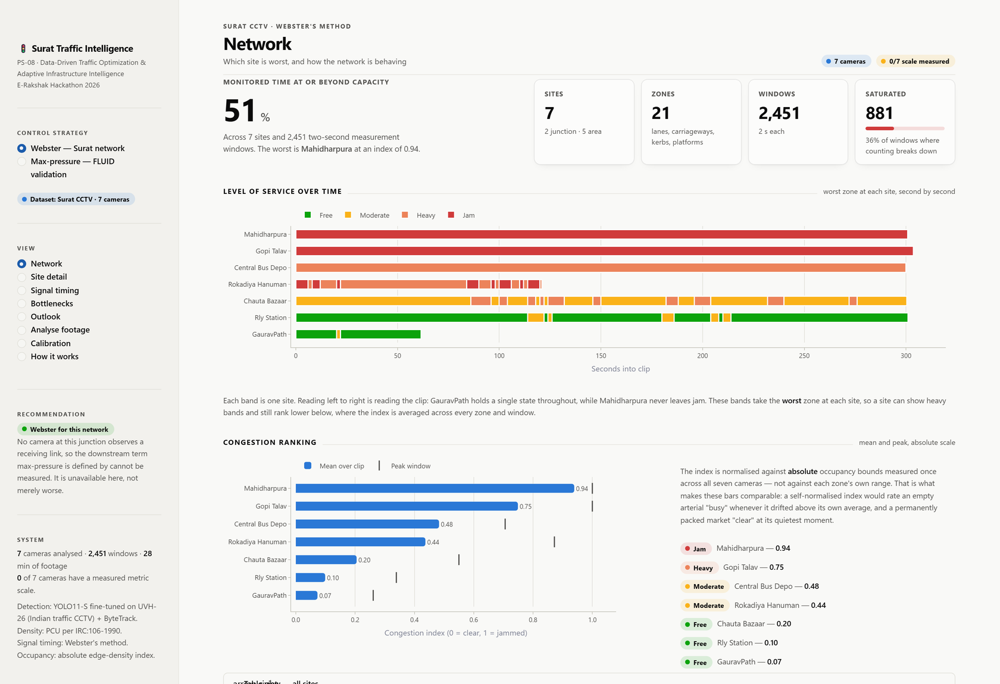
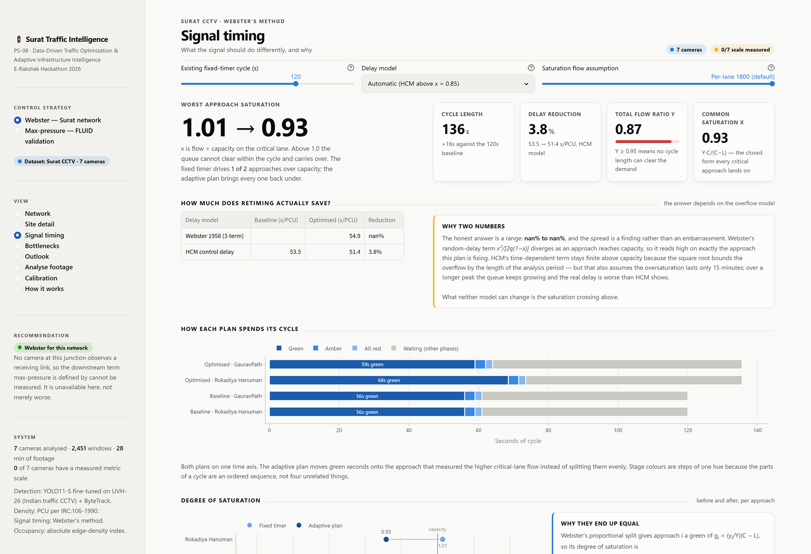
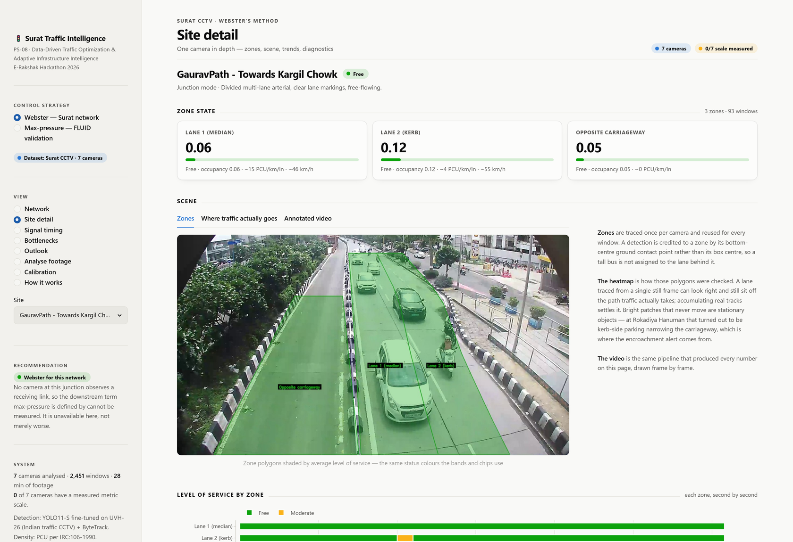
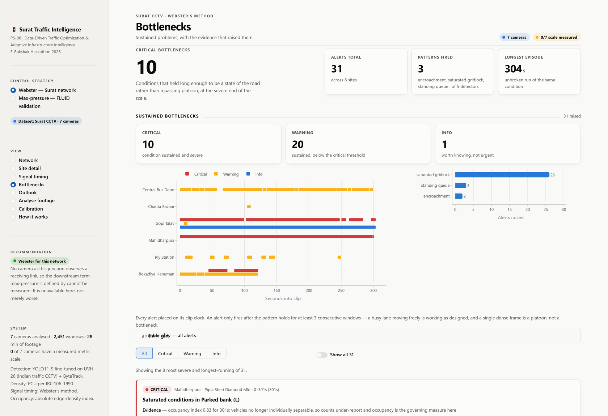
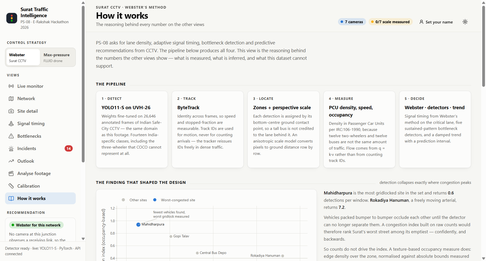
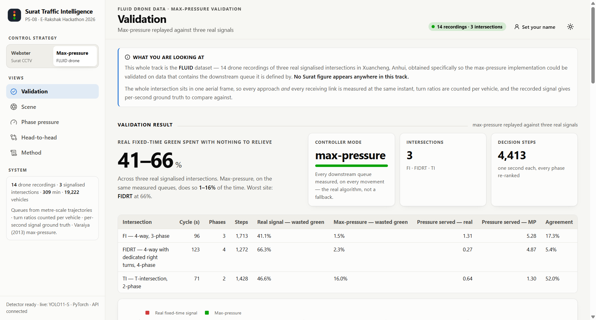
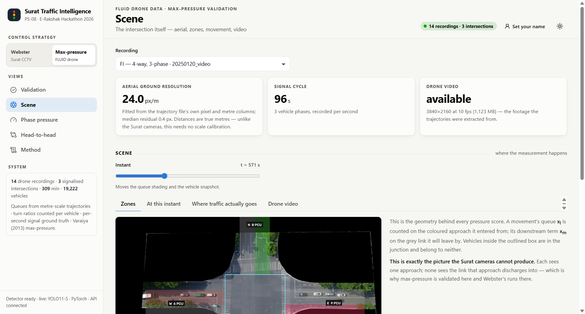
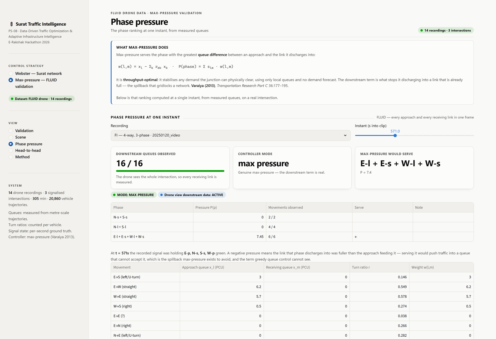
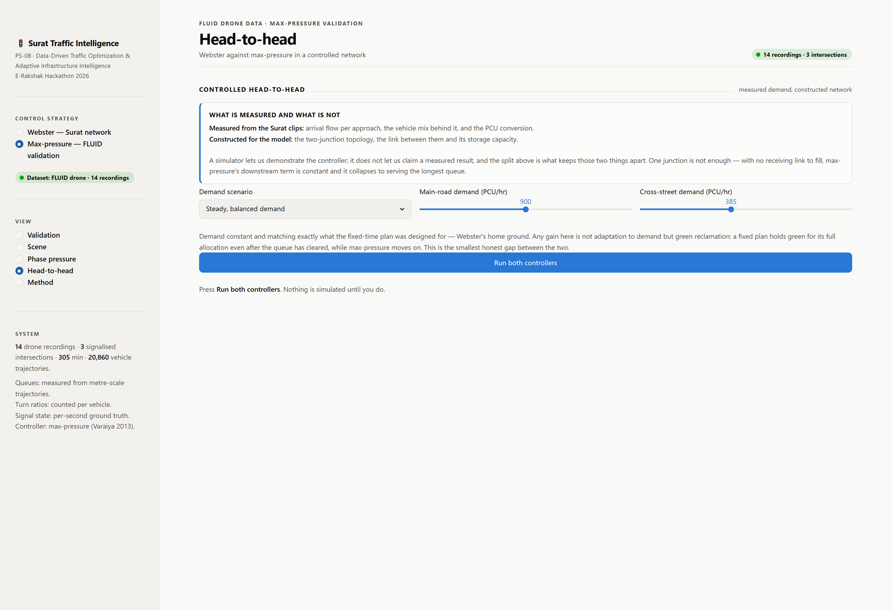

<div align="center">

# 🚦 Surat Traffic Intelligence

**Data-Driven Traffic Optimization & Adaptive Infrastructure Intelligence**
E-Rakshak Hackathon 2026 · Problem Statement **PS-08**

Real-time lane density from CCTV · adaptive signal optimisation · bottleneck detection · predictive recommendations
**— with two signal controllers, each validated on data that can actually support it.**

<br>


</div>

---

## The one-line architecture

> **Surat's junctions run Webster's. Max-pressure is validated on FLUID. Neither borrows from the other.**

Two controllers, two datasets, one strictly enforced boundary — a test fails if that ever stops being true.

| | **Webster's** | **Max-pressure** (Varaiya 2013) |
|---|---|---|
| **Needs to observe** | arrival flow on each approach | approach queue **and** the queue on the link it discharges into |
| **Cameras that requires** | one per approach | one per approach **plus one per receiving link**, or one aerial view |
| **Surat CCTV provides** | ✅ exactly this | ❌ no camera watches a receiving link |
| **Runs on** | the 7 Surat clips — **every operational figure here** | FLUID: 14 drone recordings of 3 real signalised intersections |
| **On Surat it reports** | cycle, splits, delay, saturation | `greedy-queue` — and **refuses to name a phase** |

Dropping the downstream term does not give a degraded max-pressure. It gives **greedy queue control**, which **Varaiya's §3.1 Example 2** proves fails to stabilise demands max-pressure handles. So rather than fake it, a dataset containing the missing term was obtained, and the controller is validated there.

---

## The dashboard

The sidebar's **control-strategy toggle switches the entire dashboard between two tracks.** Selecting a strategy changes which views exist — neither track can render the other's data.

### Track 1 — Webster's, on the Surat CCTV network

<div align="center">



*<b>Network</b> — level-of-service bands per site across the whole clip, and the congestion ranking on an absolute scale*

</div>

<table>
<tr>
<td width="50%"></td>
<td width="50%"></td>
</tr>
<tr>
<td><b>Signal timing</b> — cycle composition before and after on one time axis, degree of saturation as a dumbbell, and the swept delay-vs-cycle curve</td>
<td><b>Site detail</b> — zone tiles, scene overlay, movement heatmap, annotated video, per-zone trends, and the speed–density diagram</td>
</tr>
<tr>
<td></td>
<td></td>
</tr>
<tr>
<td><b>Bottlenecks</b> — every alert on a common clip clock, each carrying the evidence that raised it and a specific recommendation</td>
<td><b>How it works</b> — the occlusion finding as a chart, the fleet composition, and what this data cannot support</td>
</tr>
</table>

**Eight views:** Network · Site detail · Signal timing · Bottlenecks · Outlook · Analyse footage · Calibration · How it works

### Track 2 — Max-pressure, on the FLUID drone data

<div align="center">



*<b>Validation</b> — max-pressure replayed second by second against three real signals*

</div>

<table>
<tr>
<td width="50%"></td>
<td width="50%"></td>
</tr>
<tr>
<td><b>Scene</b> — the orthorectified aerial with approach zones shaded by live queue, receiving links in grey, junction box outlined. <b>This is the picture the Surat cameras structurally cannot produce.</b></td>
<td><b>Phase pressure</b> — the ranking at one instant, with every movement's approach queue, receiving-link queue, turn ratio and weight</td>
</tr>
</table>

<div align="center">



*<b>Head-to-head</b> — Webster against max-pressure across three demand regimes in a point-queue simulator*

</div>

**Five views:** Validation · Scene · Phase pressure · Head-to-head · Method

---

## Results

### Surat — the operational system (Webster's)

| | Baseline (fixed timer) | Webster-optimal | |
|---|---:|---:|---|
| Cycle length | 120.0 s | **135.6 s** | |
| **Worst-approach saturation *x*** | **1.01 — over capacity** | **0.929** | **crosses back under 1.0** |
| Mean delay (HCM control delay) | 53.5 s/PCU | 51.4 s/PCU | −3.8% |

The saturation crossing is the claim that survives any delay model: equal green splits drive the busier approach past capacity, where the queue never clears within the cycle. Two independent checks confirm the optimiser — sweeping cycle length puts the empirical delay minimum at **130 s** against Webster's closed form of **135.6 s**, and the optimal plan equalises degree of saturation across approaches (**0.929 / 0.929**), which is the known optimality condition for Webster green allocation.

**Network ranking** — 7 cameras, 21 zones, 2,451 measurement windows:

| Rank | Site | Mode | Mean congestion | Saturated windows |
|---|---|---|---:|---:|
| 1 | Mahidharpura – Diamond Mkt | area | **0.939** | 452 / 453 |
| 2 | Gopi Talav Gate | area | 0.749 | 167 / 456 |
| 3 | Central Bus Depo | area | 0.483 | 213 / 450 |
| 4 | Rokadiya Hanuman | junction | 0.437 | 0 / 244 |
| 5 | Chauta Bazaar | area | 0.205 | 4 / 453 |
| 6 | Rly Station | area | 0.099 | 45 / 302 |
| 7 | GauravPath | junction | 0.073 | 0 / 93 |

Plus **31 evidence-backed bottleneck alerts** (10 critical / 20 warning / 1 info) and **21 zone forecasts** with prediction intervals.

### FLUID — the max-pressure validation

Replaying max-pressure against what each real signal actually did:

| Intersection | Cycle | Phases | Real signal: green with **nothing to relieve** | Max-pressure | Pressure relieved |
|---|---:|---:|---:|---:|---:|
| **FI** (4-way, 3-phase) | 96 s | 3 | **41.1%** | 1.5% | 1.31 → **5.28** |
| **FIDRT** (4-way, dedicated right turns) | 123 s | 4 | **66.3%** | 2.3% | 0.27 → **4.87** |
| **TI** (T-intersection) | 71 s | 2 | **46.6%** | 16.0% | 0.64 → **1.30** |

These real fixed-time plans spend **41–66% of their green on a phase whose queue had already cleared** — or whose receiving link was fuller than the approach feeding it. Max-pressure, on the same measured queues, does so 1.5–16% of the time and relieves **2–18× more queue** per second of green.

That is an observation about the recorded signals, made from the recorded queues. It is deliberately **not** a delay-reduction claim: had max-pressure actually run, the queues would have evolved differently. The counterfactual needs a model:

| Scenario | Fixed-time | Max-pressure | Throughput | Spillback | Verdict |
|---|---:|---:|---:|---:|---|
| Steady, balanced | **18.6 s/PCU** | 20.8 s/PCU | −0.3% | 0 → 0 s | **fixed-time wins by 12%** |
| Demand swings between approaches | 24.5 s/PCU | **18.5 s/PCU** | +1.2% | 0 → 0 s | max-pressure **−25%** |
| Downstream blockage | 150.0 s/PCU | **102.9 s/PCU** | **+8.1%** | **289 → 88 s** | max-pressure **−31%** |

**The operator's decision rule** — narrower than the literature's enthusiasm suggests. Max-pressure earns its place when the *split* of demand moves between approaches, and above all when something downstream backs up. On steady demand it is the **worse** choice, because every extra switch pays an inter-green for a benefit that is not there. A system offering it as a straight upgrade would be selling the wrong thing.

---

## The two discoveries that shaped the design

### 1. In the worst gridlock, detection counts *fewer* vehicles, not more

| Camera | Detections | Actual condition |
|---|---:|---|
| Rokadiya Hanuman | **7,664** | flowing arterial |
| Central Bus Depo | 2,905 | busy |
| GauravPath | 1,957 | free-flowing |
| … | … | … |
| **Mahidharpura** | **463** | **worst gridlock in the dataset** |

At extreme density a wall of overlapping vehicles stops being separable and the detector's recall collapses. **A naive "more detections = more congestion" system would rank Surat's worst street among its emptiest — confidently, and backwards. Every number would look plausible.**

The fix is a texture-based occupancy index (Canny edge density, normalised against absolute bounds measured across all seven cameras) which has no notion of an object and so cannot be defeated by occlusion, plus an explicit saturation flag. Mahidharpura now flags **452 of 453 windows** as saturated and ranks correctly as the most congested site.

### 2. Only two of seven cameras can support the requested measurement

Five cameras watch market streets, a station forecourt and a bus depot — no lane discipline, no signal to optimise. "Lane density" is not a measurable quantity there, so forcing it would mean inventing numbers. Those run in **area mode** with functional zones (movement channel, encroachment, pedestrian area) and report occupancy and crowding instead.

---

## How it works

```
                         ┌─────────────────────────┐
   video (.avi/RTSP) ──▶ │  1. DETECT + TRACK      │  YOLO11-S (UVH-26) + ByteTrack
                         │     detector.py         │  → 14 Indian vehicle classes
                         └───────────┬─────────────┘
                         ┌───────────▼─────────────┐
                         │  2. LOCATE              │  lane / zone polygons,
                         │     zones.py            │  perspective scale model
                         └───────────┬─────────────┘
                         ┌───────────▼─────────────┐
                         │  3. MEASURE             │  two parallel paths
                         │     metrics.py          │
                         └───────────┬─────────────┘
                    ┌────────────────┴────────────────┐
        ┌───────────▼──────────┐         ┌────────────▼───────────┐
        │ DETECTION PATH       │         │ OCCUPANCY PATH         │
        │ PCU density, speed,  │         │ texture-based index,   │
        │ queue, flow (q=k·v)  │         │ survives saturation    │
        └───────────┬──────────┘         └────────────┬───────────┘
                    └────────────────┬────────────────┘
       ┌─────────────────────────────┼─────────────────────────────┐
┌──────▼────────┐        ┌───────────▼──────────┐       ┌──────────▼────────┐
│ 4. OPTIMISE   │        │ 5. DETECT BOTTLENECK │       │ 6. PREDICT        │
│ signal_opt.py │        │ bottleneck_detect.py │       │ forecast.py       │
│ Webster's     │        │ 5 sustained patterns │       │ damped trend +    │
│ maxpressure.py│        │ + recommendations    │       │ prediction band   │
└──────┬────────┘        └───────────┬──────────┘       └──────────┬────────┘
       └─────────────────────────────┼─────────────────────────────┘
                        ┌────────────▼─────────────┐
                        │  7. PRESENT              │
                        │  dashboard.py (2 tracks) │
                        └──────────────────────────┘
```

**Standards, not guesses.** Density in **PCU per IRC:106-1990** — twelve two-wheelers and twelve buses are not the same amount of traffic. Saturation flow from **IRC:SP:41-1994** (`S = 525·W`, width-based, because lane count is precisely what this data cannot pin down). Pedestrian minimum green from **IRC:103-2012**, computed from each approach's own crossing width at a conservative 0.8 m/s.

**The detection weights matter more than the architecture.** UVH-26 is YOLO11 fine-tuned on 26,646 annotated frames of Indian Safe-City CCTV — the same domain as this footage — giving 14 India-specific classes including the auto-rickshaw, which **COCO does not have at all** and which dominates most of these clips.

**Flow is never counted from tracker IDs.** ByteTrack reissues IDs whenever a track drops briefly, which is constant in dense mixed traffic, so counting them inflated flow tenfold. Flow comes from the fundamental relation **q = k·v** instead, on directly measured density and speed.

---

## Quick start

```bash
pip install -r requirements.txt
streamlit run src/dashboard.py
```

That is the whole thing. The metrics CSVs and reference frames are committed, so **the Webster track works immediately** — no video download, no GPU, no model weights, and no torch. `requirements.txt` is the slim dashboard set for exactly that reason; it is also what a deployment installs.

<details>
<summary><b>Full pipeline, from raw video</b></summary>

Analysing new footage needs the detector, so install the full set instead — **not both**, as they pin different OpenCV builds (`requirements-full.txt` explains why).

```bash
pip install -r requirements-full.txt
python scripts/download_models.py         # UVH-26 YOLO11 weights, ~55 MB
python src/reference_frames.py            # clean frame per camera
python src/seed_calibration.py            # first-pass lane / zone polygons
python src/calibrate.py rokadiya_hanuman  # (optional) refine by hand
python src/analyze.py --all --stride 4    # detect → track → measure → CSV
python src/traffic_heatmap.py --all       # where traffic actually goes
python src/render_demo.py --junctions     # annotated MP4s
streamlit run src/dashboard.py
```

Throughput is ≈12 FPS at 960 px on 1080p input on an RTX 3050 6 GB — faster than real time at stride 2.
</details>

<details>
<summary><b>Datasets — not in this repository</b></summary>

Neither dataset is committed: the Surat exports are the problem statement's own data, and FLUID is 19 GB with its own DOI.

**Surat CCTV** — 7 clips, 1920×1080 @ 20 fps, ≈31.5 min total. Place the `.avi` files in the project root.

**FLUID** — *A Fine-grained Lightweight Urban signalized-Intersection Dataset with Dense conflict trajectories.* Xuancheng, Anhui, China; DJI Mini 3 at 100–120 m; metre-scale trajectories, per-second signal state, per-vehicle turn annotation.
figshare DOI **`10.6084/m9.figshare.29974954`** · CC BY 4.0 · ≈18 GB.
Extract anywhere and set `FLUID_ROOT`, or drop it in the project root as `29974954/`.
</details>

<details>
<summary><b>Troubleshooting</b></summary>

- **No scene images** → `python src/reference_frames.py` has not been run; the overlays are drawn onto those frames.
- **"Model weights not found"** → `python scripts/download_models.py`. Every other view works without them, because they read the committed CSVs.
- **Max-pressure track says "FLUID not found"** → set `FLUID_ROOT` to wherever you extracted it.
- **`No start code is found.` in the terminal** → already suppressed. It was FFmpeg noting that H.264-in-AVI carries no parameter sets at the container boundary, then decoding correctly anyway.
</details>

---

## Verification

```bash
python tests/verify_system.py     # 18 checks
```

Every figure quoted in this README and in `REPORT.md` is **recomputed and compared**, so the documentation cannot drift from the code. The suite also asserts the things that matter most:

- **The separation** — the Surat plan is recomputed under both controller settings and must come out byte-identical, and the string `maxpressure` must not appear in any of the nine measurement and analysis modules.
- **The observability gate** — max-pressure must *refuse* on Surat and *run* on FLUID.
- **Scale invariance** — multiplying every queue by 7.3 must leave the phase choice unchanged (it scales the pressure by exactly 7.30).
- **Simulator fairness** — both controllers must be charged the same lost time, and all three demand scenarios must genuinely differ from one another.
- **Geometry** — the world-to-pixel fit on every FLUID site must land within 5 px; a per-axis fit missed by 8 m on the site rotated 157°.
- **Physical sanity** — no zero-length measurement window, and no speed, density or occupancy outside its physical range.

---

## Honest limitations

**The metric scale is not calibrated.** Converting pixels to metres needs one true ground reference — a surveyed width, camera intrinsics, or a landmark of known size. This dataset ships none, and three independent recovery attempts disagreed with each other by a factor of two to four. So the system separates what it **measures** from what it **estimates**:

- **Scale-free and trustworthy** — congestion index, level of service, site ranking, occupancy, lane comparison, and the entire signal-timing before/after comparison.
- **Scale-dependent estimates** — anything in km/h, PCU/km/lane or PCU/hr. Displayed with a `~` prefix behind a persistent banner.

Every headline result above is in the first category. One measured road width promotes the rest, and the **Calibration** view does it in about two minutes without a site visit.

**Other limits, stated rather than hidden.** Lane polygons are traced and heatmap-validated, not surveyed. The two junction cameras face different corridors rather than opposing approaches of one intersection, so the combined signal plan demonstrates the method on real measured demand rather than being deployable at a specific junction. Forecasting has minutes of history, not weeks. FLUID is Chinese traffic — it validates that the *controller implementation* is correct on data containing the terms it needs, and no claim from it transfers to Surat's fleet.

---

## Repository layout

| Path | Contents |
|---|---|
| `src/detector.py` · `zones.py` · `metrics.py` · `analyze.py` | Detection, tracking, zone geometry, and the measurement engine |
| `src/signal_opt.py` | Webster's cycle and splits, HCM delay, IRC saturation flow, pedestrian minima, controller recommender |
| `src/maxpressure.py` | Max-pressure with the observability gate that refuses rather than guess a missing downstream queue |
| `src/fluid.py` | FLUID adapter — queues, turn ratios, phase recovery, replay, and the aerial scene layer |
| `src/network_sim.py` | Point-queue simulator over two junctions in series |
| `src/bottleneck_detect.py` · `forecast.py` | Five sustained-pattern detectors; damped trend with prediction intervals |
| `src/dashboard.py` · `theme.py` · `charts.py` | The two-track UI, the validated visual system, and every figure |
| `src/calibration.py` · `ingest.py` · `report_html.py` | Metric-scale calibration, uploaded-footage analysis, downloadable reports |
| `tests/verify_system.py` | 18 end-to-end checks |
| **[`REPORT.md`](REPORT.md)** | **The full engineering report — every design decision, every bug found, every number derived** |
| [`ATTRIBUTION.md`](ATTRIBUTION.md) | Third-party libraries, datasets, pre-trained models and standards — and what is our own work |
| [`DATA_SCHEMA.md`](DATA_SCHEMA.md) | Every column of the metrics CSV, the camera/zone config, and the FLUID inputs |
| [`DEPLOYMENT.md`](DEPLOYMENT.md) | How to deploy, and what a hosted instance can and cannot show |
| [`LICENSE`](LICENSE) | AGPL-3.0 — inherited from Ultralytics; see `ATTRIBUTION.md` §6 |

---

<div align="center">

**[📄 Read the full engineering report →](REPORT.md)**

*Built for E-Rakshak Hackathon 2026 · Problem Statement PS-08*

</div>
